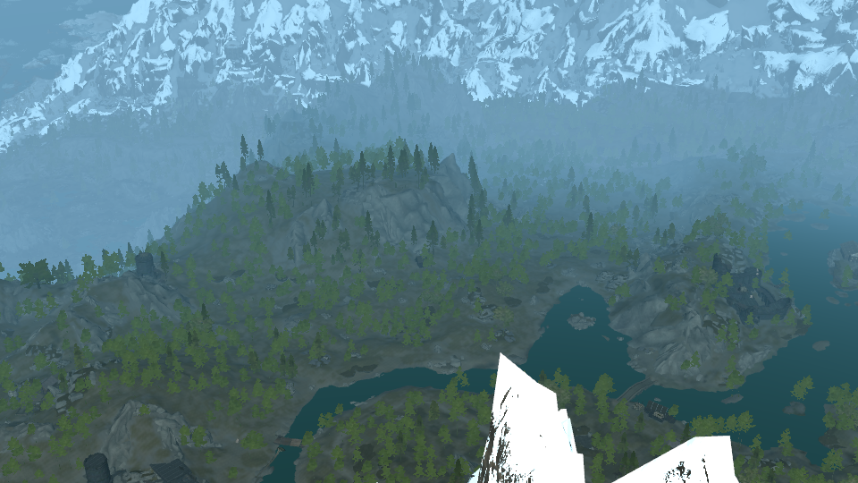
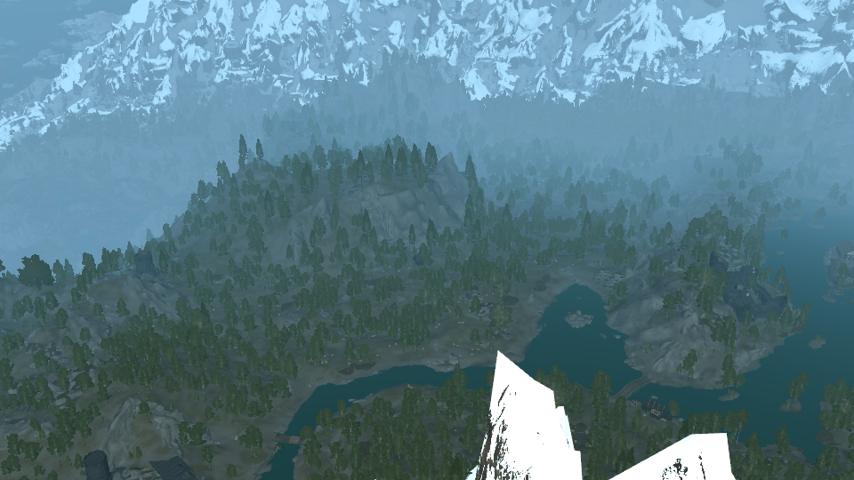

# Tree impostors: atlas layout and shader contract

LODForge bakes every tree type of a worldspace into **hemi-octahedral impostors**: N x N
orthographic views of the model over the upper hemisphere, stored in two atlases. The LODForge
runtime draws one camera-facing quad per tree instance and picks (and blends) the frames that
match the view direction. This document is the contract between the baker
(`crates/impostor`, `lodforge impostors`, `lodforge build --impostors`) and every shader that
draws the impostors. The viewer's `vs_impostor` / `fs_impostor`
(`crates/viewer/src/render/shaders.wgsl`) is the reference implementation; `lodforge view
--layers terrain,objects,impostors --impostors <folder>` shows it.

Math and conventions are ported from Project Terra (`HemiOctMath.cs`, `TreeImpostorCapture.cs`,
`TreeImpostorCore.hlsl`), moved from Unity's Y-up, left-handed space to Skyrim's Z-up,
right-handed model space.

## Files

Per worldspace, under `textures\LODForge\Impostors\<World>\`:

| File | Content |
| --- | --- |
| `impostors.json` | Set index: pages and every type (the same objects as the per-type files). |
| `types\<name>.json` | One type (fields below). |
| `pageNN.dds` | Albedo + coverage, BC7 (`DXGI_FORMAT_BC7_UNORM`, DX10 header), full mip chain for the page's smallest frame size. |
| `pageNN_nd.dds` | Normal + slab depth, BC7, same size and mips. |
| `preview-instances.bin` | Temporary (viewer only, `--preview-instances`); see the end. |

`LODForge_ImpostorReport_<World>.csv` at the output root lists every type with its layout, bake
time and bytes.

A type's **index** is its position in `impostors.json` `types`. Types are sorted by `name`.
The instance files refer to types by that index: a `<World>[.<SEASON>].trees.bin` record's `type`
is this index, and its `TTYP` table repeats this list in the same order with the same `name`,
`model` and `model_crc32` (docs/runtime/instance-formats.md section 3.2). One set covers every
season of the worldspace. `build --runtime lodforge` runs the object LOD export first, adds every tree base the runtime
will draw to the set (besides TexGen's candidates), bakes it, then writes the trees files; trees
whose base still has no type (the bake failed: no geometry or no renderable texture) stay in
object LOD.

### Type fields

| Field | Meaning |
| --- | --- |
| `name` | `<model stem>_<crc32 of the lower-case model path>`: the type's identity. |
| `model` | Data-relative model rendered (lower case): the record's MODL, or TexGen's `_static` replacement. |
| `record_model`, `model_crc32` | The record's MODL and the CRC-32 of the model file. |
| `bases` | TREE / STAT records drawn with this type: `plugin` (lower-case file name), `form_id` (hex, without the load-order byte(s); `00000xxx` for light plugins), `editor_id`. |
| `grid` | N: frames per side. |
| `frame_px` | Frame size in texels. |
| `atlas_px` | `grid * frame_px`, the type's square on its page. |
| `quad_size` | Q: edge of the quad in model units at reference scale 1 (the bounding sphere's diameter, `2r`). |
| `bounds_center_offset` | C: model origin (trunk base) to the impostor centre, model units. |
| `bounds_min`, `bounds_max` | Model-space AABB of the rendered geometry. |
| `page`, `albedo`, `normal_depth` | Page index and its two textures (Data-relative). |
| `rect_px` | `[x, y, w, h]` of the type on its page, texels, top-left origin. |
| `rect` | The same normalised by the page size: `[u0, v0, du, dv]`. |
| `coverage` | Mean alpha of the type's frames (0..1). |
| `cache_key` | Bake cache key (types with equal keys share one rectangle). |

## Capture

- **Centre and radius.** C is the centre of the model's AABB; r is the largest distance of a
  vertex from C. Every frame is an orthographic view of the square `[-r, r]^2` about C, so the
  whole model fits every frame. Q = 2r.
- **Frame directions.** Frame (i, j) is captured from `dir = decode((i, j) / (N - 1))`
  (grid-**vertex** sampling): the perimeter frames lie on the horizon, the centre of an odd grid
  is the top-down view.
- **Frame basis.** For `dir` (from the tree toward the camera):
  `right = normalize(cross(+Z, dir))`, `up = cross(dir, right)`; when `|dir.z| >= 0.999`,
  `right = +X`, `up = +Y`. `right x up = dir`. Image x grows along `right`, image rows run along
  `-up` (top row = `+up`).
- **Lighting.** Albedo is unlit: diffuse texture times vertex colour (no PBR scale, no specular).
- **Supersampling.** Frames render at 4x per axis and are averaged down: alpha is fractional
  coverage, colour the coverage-weighted mean.
- **Dilation.** Each frame is dilated on its own (16 rings, 8 neighbours) under the albedo
  coverage mask: covered colours, normals and depths flood into the empty texels so filtering
  never pulls in background. Coverage itself stays 0 there.

## Atlas layout

- A type occupies `rect_px` on its page: a square of N x N cells, `frame_px` each.
- **Frame (i, j) is cell column i, row j, rows counted from the top**:
  cell texels `[x + i * F, x + (i + 1) * F) x [y + j * F, y + (j + 1) * F)`, F = `frame_px`.
- In normalised page uv (D3D convention, v down):
  `cell(i, j) = rect.xy + (i, j) * rect.zw / N`, size `rect.zw / N`.
- Rectangles start on multiples of 128 texels; frame sizes are powers of two (32, 64 or 128 by
  default), so frame boundaries stay aligned through `log2(F) + 1` mip levels.

Default layouts (frame size = next power of two of `height * max(1, min(2, max ref scale)) / 12`,
clamped to 32..128; grid 16 up to 64 px frames, 12 above):

| Layout | Atlas | Typical trees |
| --- | --- | --- |
| 16 x 16 x 32 px | 512 | shrubs, saplings |
| 16 x 16 x 64 px | 1024 | small trees |
| 12 x 12 x 128 px | 1536 | most full-size trees (pines, oaks, aspens) |

## Channel encodings

**Albedo page** (`pageNN.dds`):

| Channel | Content |
| --- | --- |
| RGB | Albedo, **sRGB-encoded** (as the source textures). Create the SRV as `BC7_UNORM_SRGB` for linear values, or decode in the shader. |
| A | Coverage (0..1). Alpha-test it (the reference uses 0.4). |

**Normal + depth page** (`pageNN_nd.dds`), linear:

| Channel | Content |
| --- | --- |
| RGB | Model-space shading normal (normal maps applied, two-sided cards turned toward the viewer), `n * 0.5 + 0.5`. Z up. Not tangent space. |
| A | Slab depth: `(dot(C, dir) + r - dot(p, dir)) / 2r`, 0 at the camera side of the bounding sphere, 0.5 at the centre plane, 1 at the far side. |

Texels without coverage hold dilated values (or `(0.5, 0.5, 1, 1)`: up, far) and must be ignored
through the albedo coverage.

## Shader contract

### Instance transform

An instance has position `P`, Z rotation `yaw` (radians, as the REFR stores it) and uniform
scale `s`. Skyrim's reference rotation is clockwise: **world = P + Rz(-yaw) * (s * model)**,
model = Rz(yaw) * (world - P) / s, with `Rz(a) = [[cos a, -sin a, 0], [sin a, cos a, 0], [0, 0, 1]]`.
(Tilted references, x/y rotation > 30 degrees, are not drawn as impostors.)

### Vertex stage (per instance, the same for its four corners)

```hlsl
// Hemi-octahedral mapping (z >= 0); exact inverses on the upper hemisphere.
float2 HemiOctEncode(float3 d) {
    float n = abs(d.x) + abs(d.y) + d.z;
    float x = d.x / n, y = d.y / n;
    return float2(x + y, x - y) * 0.5 + 0.5;
}
float3 HemiOctDecode(float2 uv) {
    float s = uv.x * 2 - 1, t = uv.y * 2 - 1;
    float x = (s + t) * 0.5, y = (s - t) * 0.5;
    return normalize(float3(x, y, 1 - abs(x) - abs(y)));
}
void FrameBasis(float3 dir, out float3 right, out float3 up) {
    if (abs(dir.z) < 0.999) { right = normalize(cross(float3(0, 0, 1), dir)); up = cross(dir, right); }
    else { right = float3(1, 0, 0); up = float3(0, 1, 0); }
}

// 1. View direction in model space, from the impostor centre.
float3 camM = mul(RzYaw, camWorld - P) / s - C;        // RzYaw = Rz(+yaw)
float3 dir  = normalize(camM);
dir = normalize(float3(dir.xy, max(dir.z, 0.02)));     // below the horizon: reuse the ring
// (Shadow / light views: dir = the light direction in model space instead.)

// 2. The three frames of the enclosing grid triangle and their weights.
float  m  = N - 1;
float2 g  = saturate(HemiOctEncode(dir)) * m;
float2 b  = min(floor(g), m - 1);
float2 f  = g - b;
float2 i0, i1 = b + float2(1, 0), i2 = b + float2(0, 1); float3 w;
if (f.x + f.y <= 1) { i0 = b;             w = float3(1 - f.x - f.y, f.x, f.y); }
else                { i0 = b + float2(1, 1); w = float3(f.x + f.y - 1, 1 - f.y, 1 - f.x); }

// 3. The quad: corner (cx, cy) in {-0.5, 0.5}^2 in the view direction's own basis.
float3 R, U; FrameBasis(dir, R, U);
float3 p = (R * cx + U * cy) * Q;                       // model space, relative to C
float3 world = P + mul(Rz(-yaw), (C + p) * s);

// 4. Frame-local uv (v down) of the corner in each of the three frames.
float2 FrameUv(float3 p, float2 idx) {
    float3 d = HemiOctDecode(idx / (N - 1)); float3 r, u; FrameBasis(d, r, u);
    return float2(0.5 + dot(p, r) / Q, 0.5 - dot(p, u) / Q);
}
// Interpolate (i_k, FrameUv(p, i_k)) and w to the pixel stage; i_k and w are constant per instance.
```

Projecting the same corner onto each frame's own plane (instead of reusing the quad uv) is what
keeps the three frames registered with each other while the view moves between them.

### Pixel stage

```hlsl
float2 AtlasUv(float2 idx, float2 local) {
    float inset = 0.5 / frame_px;                       // stay inside the frame's cell
    return rect.xy + (idx + clamp(local, inset, 1 - inset)) * rect.zw / N;
}
// Sample albedo (a_k) and normal-depth (nd_k) of the three frames at AtlasUv(i_k, local_k).
// A frame whose local uv lies outside 0..1 has no coverage there.
float alpha = dot(w, float3(a0.a, a1.a, a2.a) * inside);
clip(alpha - 0.4);
float3 cw = w * float3(a0.a, a1.a, a2.a) * inside;      // colour/normal weights
float3 albedo = (cw.x * a0.rgb + cw.y * a1.rgb + cw.z * a2.rgb) / max(dot(cw, 1), 1e-4);
float3 nBaked = normalize(cw.x * (nd0.rgb * 2 - 1) + cw.y * (nd1.rgb * 2 - 1) + cw.z * (nd2.rgb * 2 - 1));
// Optional canopy-shell normal for stable far shading (Terra): per frame
// shell_k = r_k * (local_k.x - 0.5) + u_k * (0.5 - local_k.y) + d_k * (0.5 - nd_k.a),
// blended with w; n = normalize(lerp(shell, nBaked, detail)), detail ~0.35..0.6, less far away.
float3 nWorld = mul(Rz(-yaw), n);
```

- **Depth.** For a per-pixel depth offset, the texel's distance toward the camera from the
  centre plane is `(0.5 - nd.a) * Q * s` along the view direction.
- **Nearest frame** (M2 runtime, before the 3-frame blend): the frame with the largest weight
  `w`; dither frame changes.
- **Mips.** Sample with a clamp sampler and normal mip selection; the half-texel inset uses the
  top level's `frame_px` (deep mips blend neighbouring frames slightly, acceptable at that
  distance).

## Bake cache and sharing

Bakes are cached (default `%LOCALAPPDATA%\LODForge\cache\impostors`, `--impostor-cache`) by an
FNV-1a key over: the model's CRC-32, each texture's path and CRC-32, grid, frame size, dilation,
supersampling, and the baker version. Types with the same key (identical model and textures under
another path, common in Skyrim's per-hold tree copies) share one atlas rectangle.

## Measured: skyrim-cs-base Tamriel (2026-10-24)

`lodforge impostors --instance D:\Modlists\skyrim-cs-base --worlds Tamriel --preview-instances`,
default settings, empty cache, CPU BC7 (`--bc7 high`):

- **348 types** (one per rendered model) for 380 tree bases with references; 88,741 instances.
  101 types share an identical bake with another type (same model and texture bytes under another
  path, e.g. the per-hold `haafingar_*` / `whiterun_*` copies), so 247 unique rectangles.
- **Time**: 5.3 min in all: bake 279 s, page encode 37 s. Per baked type: 512 px atlas mean
  0.49 s, 1024 px 0.60 s, 1536 px 1.47 s (max 9 s, the first type of a run pays texture
  uploads). Cached reruns of a type take ~50 ms.
- **Size**: 39 pages of 4096 px (BC7, mips), 1.09 GiB on disk:

  | Layout | Types | Unique | BC7 + mips (both maps) |
  | --- | --- | --- | --- |
  | 12 x 12 x 128 px (1536) | 250 | 153 | 918 MiB |
  | 16 x 16 x 64 px (1024) | 31 | 27 | 72 MiB |
  | 16 x 16 x 32 px (512) | 67 | 67 | 45 MiB |

  `--impostor-max-frame 64` puts the 1536 types at 16 x 16 x 64 px (2.7 MiB each, about
  530 MiB in all); the runtime's residency streaming (M2b) is the other lever.
- 2 bases bake nothing: `deadshrub01.nif` (no renderable texture) and
  `haafingar_tundradriftwood01.nif` (no geometry).

Viewer golden screenshots (`lodforge view --levels 4 --camera 100000,-112000,40000,45,-28
--fov 50`, the Rift): classic billboard tree LOD (`--layers terrain,water,objects,trees`, the
2026-10-22 cs-base build) against the impostor preview (`--layers
terrain,water,objects,impostors --impostors <set folder>`):




The impostors keep their silhouette from above (billboards turn into flat cards), and carry
no baked lighting: they are lit from the baked normals, so they read darker than TexGen's
pre-lit billboards (direct 1.35 + ambient 0.55). Brightness matching is a runtime setting
(Terra uses a 1.2 boost).

## Preview instances (temporary)

`preview-instances.bin` exists only until the runtime instance files land: `"LFPI"`, u32 version
1, u32 count, then per record `pos.xyz, yaw, scale` (f32) and `type index` (u32), 24 bytes. It
holds every reference of the worldspace whose base is one of the set's types, without deleted,
initially disabled, never-enabled (enable parent = player, opposite state) and tilted
references.
